# DER: modelo de dados

Diagrama entidade-relacionamento do banco PostgreSQL da API, na notação pé de galinha. As tabelas, colunas, tipos, chaves e cardinalidades são os das migrations em `database/migrations/`: o teste `tests/functional/der.spec.ts` compara este diagrama com o banco migrado e falha se os dois divergirem. As seções de texto abaixo (restrições `CHECK`, unicidade composta e ações das chaves estrangeiras) e os comentários do diagrama são mantidos à mão, junto com as migrations.

```mermaid
erDiagram
    unidades {
        int id PK
        varchar codigo UK
        varchar nome
        varchar formato "COMPLETA, REDUZIDA"
        varchar cidade
        varchar estado "UF"
        varchar endereco
        varchar telefone
        boolean ativa
        timestamptz created_at
        timestamptz updated_at
    }

    users {
        int id PK
        varchar full_name
        varchar email UK
        varchar password "hash scrypt"
        varchar perfil "CLIENTE, ATENDENTE, COZINHA, GERENTE, ADMIN"
        varchar telefone
        date data_nascimento
        int unidade_id FK "equipe da unidade"
        timestamptz consentimento_dados_em "LGPD"
        timestamptz consentimento_fidelidade_em "LGPD"
        timestamptz consentimento_marketing_em "LGPD"
        timestamptz anonimizado_em "LGPD"
        timestamptz created_at
        timestamptz updated_at
    }

    auth_access_tokens {
        int id PK
        int tokenable_id FK
        varchar type
        varchar name
        varchar hash
        text abilities
        timestamptz created_at
        timestamptz updated_at
        timestamptz last_used_at
        timestamptz expires_at
    }

    produtos {
        int id PK
        varchar codigo UK
        varchar nome
        text descricao
        varchar categoria
        numeric preco_base
        boolean sazonal
        boolean ativo
        timestamptz created_at
        timestamptz updated_at
    }

    unidade_produtos {
        int id PK
        int unidade_id FK "UNIQUE (unidade_id, produto_id)"
        int produto_id FK
        numeric preco "preço local"
        boolean disponivel
        timestamptz created_at
        timestamptz updated_at
    }

    estoques {
        int id PK
        int unidade_id FK "UNIQUE (unidade_id, produto_id)"
        int produto_id FK
        int quantidade "CHECK >= 0"
        int quantidade_minima
        timestamptz created_at
        timestamptz updated_at
    }

    movimentacoes_estoque {
        int id PK
        int estoque_id FK
        int pedido_id FK
        int usuario_id FK
        varchar tipo "ENTRADA, SAIDA, AJUSTE"
        int quantidade
        int saldo_resultante
        varchar motivo
        timestamptz created_at
        timestamptz updated_at
    }

    pedidos {
        int id PK
        varchar codigo UK
        int unidade_id FK
        int cliente_id FK
        varchar canal_pedido "APP, TOTEM, BALCAO, PICKUP, WEB"
        varchar status "AGUARDANDO_PAGAMENTO, PAGO, EM_PREPARO, PRONTO, ENTREGUE, CANCELADO"
        numeric subtotal
        numeric desconto
        numeric total
        int pontos_gerados
        text observacoes
        timestamptz cancelado_em
        varchar motivo_cancelamento
        timestamptz created_at
        timestamptz updated_at
    }

    pedido_itens {
        int id PK
        int pedido_id FK
        int produto_id FK
        varchar nome_produto "cópia no momento da compra"
        int quantidade "CHECK > 0"
        numeric preco_unitario "cópia no momento da compra"
        numeric subtotal
        timestamptz created_at
        timestamptz updated_at
    }

    pagamentos {
        int id PK
        int pedido_id FK, UK "um pagamento por pedido"
        varchar status "PENDENTE, APROVADO, RECUSADO, ESTORNADO"
        varchar metodo "PIX, CARTAO_CREDITO, CARTAO_DEBITO, DINHEIRO"
        numeric valor
        varchar referencia_externa UK "id no provedor"
        varchar motivo_recusa
        jsonb payload_requisicao
        jsonb payload_resposta
        jsonb payload_webhook
        jsonb payload_estorno
        timestamptz processado_em
        timestamptz estornado_em
        timestamptz created_at
        timestamptz updated_at
    }

    fidelidade_contas {
        int id PK
        int cliente_id FK, UK "uma conta por cliente"
        int saldo_pontos "CHECK >= 0"
        timestamptz aderiu_em
        timestamptz created_at
        timestamptz updated_at
    }

    fidelidade_movimentos {
        int id PK
        int conta_id FK
        int pedido_id FK
        varchar tipo "ACUMULO, RESGATE, EXPIRACAO, ESTORNO"
        int pontos
        int saldo_resultante
        varchar descricao
        timestamptz created_at
        timestamptz updated_at
    }

    promocoes {
        int id PK
        int unidade_id FK "nula: vale para a rede"
        varchar codigo UK
        varchar nome
        varchar tipo "PERCENTUAL, VALOR_FIXO, PONTOS_EXTRA"
        numeric valor
        varchar canal_pedido "nulo: vale para todos os canais"
        numeric valor_minimo_pedido
        timestamptz inicia_em
        timestamptz termina_em
        boolean ativa
        timestamptz created_at
        timestamptz updated_at
    }

    logs_auditoria {
        int id PK
        int usuario_id FK "nulo: ação do sistema"
        varchar acao
        varchar entidade
        varchar entidade_id
        jsonb dados
        varchar ip
        varchar request_id
        timestamptz created_at
        timestamptz updated_at
    }

    unidades |o--o{ users : "vincula a equipe"
    users ||--o{ auth_access_tokens : "autentica com"
    unidades ||--o{ unidade_produtos : "oferta no cardápio"
    produtos ||--o{ unidade_produtos : "é ofertado em"
    unidades ||--o{ estoques : "mantém"
    produtos ||--o{ estoques : "é estocado em"
    estoques ||--o{ movimentacoes_estoque : "registra"
    pedidos |o--o{ movimentacoes_estoque : "origina"
    users |o--o{ movimentacoes_estoque : "executa"
    unidades ||--o{ pedidos : "recebe"
    users |o--o{ pedidos : "faz"
    pedidos ||--o{ pedido_itens : "contém"
    produtos ||--o{ pedido_itens : "é vendido em"
    pedidos ||--o| pagamentos : "é pago por"
    users ||--o| fidelidade_contas : "possui"
    fidelidade_contas ||--o{ fidelidade_movimentos : "acumula"
    pedidos |o--o{ fidelidade_movimentos : "gera"
    unidades |o--o{ promocoes : "restringe"
    users |o--o{ logs_auditoria : "executa"
```

## Leitura das cardinalidades

| Notação | Lado  | Significado                                                   |
| ------- | ----- | ------------------------------------------------------------- |
| `\|\|`  | pai   | exatamente um: a chave estrangeira é obrigatória (`NOT NULL`) |
| `\|o`   | pai   | zero ou um: a chave estrangeira aceita nulo                   |
| `o{`    | filha | zero ou muitos                                                |
| `o\|`   | filha | zero ou um: a chave estrangeira também é única                |

## Restrições

| Tabela                                                  | Restrição                                                    | Por quê                                                                                                           |
| ------------------------------------------------------- | ------------------------------------------------------------ | ----------------------------------------------------------------------------------------------------------------- |
| `estoques`                                              | `CHECK (quantidade >= 0)`, `UNIQUE (unidade_id, produto_id)` | o saldo nunca fica negativo, mesmo com pedidos simultâneos; um saldo por produto em cada unidade                  |
| `unidade_produtos`                                      | `UNIQUE (unidade_id, produto_id)`                            | a unidade não repete o produto no cardápio                                                                        |
| `pedido_itens`                                          | `CHECK (quantidade > 0)`                                     | item sem quantidade não é item                                                                                    |
| `pagamentos`                                            | `UNIQUE (pedido_id)`, `UNIQUE (referencia_externa)`          | no máximo um pagamento por pedido, base da idempotência da solicitação; o identificador do provedor não se repete |
| `fidelidade_contas`                                     | `CHECK (saldo_pontos >= 0)`, `UNIQUE (cliente_id)`           | o saldo não fica negativo; uma conta por cliente                                                                  |
| `users`, `unidades`, `produtos`, `pedidos`, `promocoes` | `UNIQUE` em `email` ou `codigo`                              | identificador de negócio sem repetição                                                                            |

As ações nas chaves estrangeiras seguem a natureza de cada vínculo:

- **`CASCADE`** onde a filha não existe sem o pai: itens e pagamento do pedido, cardápio e estoque da unidade, movimentações do estoque, tokens do usuário, conta e movimentos de fidelidade, promoções da unidade.
- **`RESTRICT`** onde apagar o pai apagaria histórico: unidade ou cliente de um pedido, produto vendido, estocado ou ofertado, unidade da equipe.
- **`SET NULL`** onde o registro sobrevive sem o vínculo: movimentações de estoque e de fidelidade sem o pedido ou o usuário, e a trilha de auditoria sem o usuário.

As colunas de valores fechados (status, canal, perfil, tipo) são `varchar` sem `CHECK` no banco: a lista válida vive no model e é aplicada pelo validator na entrada, como explica o README. Os valores aparecem no diagrama como comentário.
