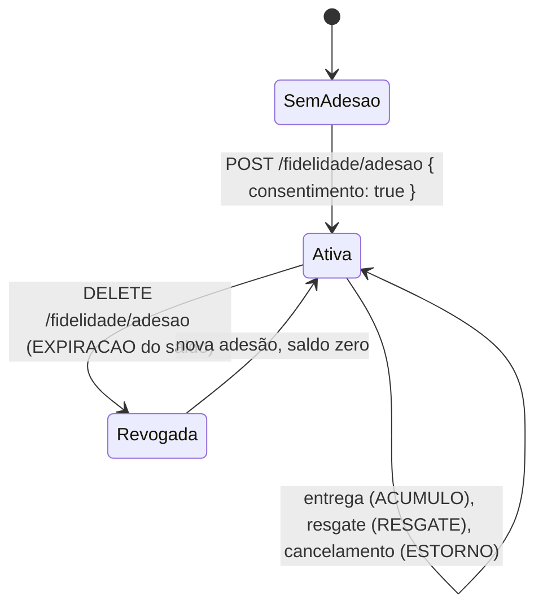

# Fidelidade e promoções

[Voltar ao README](../README.md)

## Fidelidade

O programa de pontos é opcional e depende de consentimento explícito, como pede o caso: *"conhecer o cliente é importante, mas respeitar sua privacidade é obrigatório"*.

| Regra | Valor |
|---|---|
| Acúmulo | 1 ponto por real do total pago, creditado quando o pedido é `ENTREGUE` |
| Resgate | R$ 0,05 por ponto, como desconto na criação do pedido (`pontosResgatados`) |
| Limite do desconto | 50% do subtotal |

As regras são constantes no model `FidelidadeConta` e voltam em `GET /api/v1/fidelidade`, para o app mostrá-las sem duplicar valores.

- **Adesão é consentimento.** `POST /fidelidade/adesao` só aceita `{ "consentimento": true }`; qualquer outro corpo é `422`. A data fica em `users.consentimento_fidelidade_em`, a conta é aberta e a auditoria registra `fidelidade.aderida`. A base legal é o consentimento (LGPD, art. 7º, I), porque cruzar o histórico de consumo para dar benefícios não é necessário para vender um lanche.
- **Pontos só na entrega.** Um pedido entregue não pode mais ser cancelado, então ponto ganho nunca precisa ser estornado. Creditar na aprovação do pagamento obrigaria a retirar os pontos num cancelamento posterior, e eles já poderiam ter sido gastos.
- **O resgate sai na criação e volta no cancelamento.** Os pontos são debitados na mesma transação do pedido, com a conta travada (`SELECT ... FOR UPDATE`), e todo cancelamento (pelo cliente, pela operação ou pela recusa do pagamento) devolve o que foi resgatado com um movimento de `ESTORNO`. Há um teste que dispara dois pedidos simultâneos gastando o mesmo saldo e exige um `201` e um `409`; sem a trava, os dois passam.
- **Revogar vale a qualquer momento** (art. 8º, § 5º). `DELETE /fidelidade/adesao` limpa a data do consentimento, zera o saldo com um movimento de `EXPIRACAO` e registra `fidelidade.revogada`. A conta e o extrato ficam, porque sustentam os descontos já concedidos em pedidos; a partir dali nada mais é acumulado nem resgatado, nem devolvido por cancelamento. Uma nova adesão reabre a mesma conta, com saldo zero.
- **Extrato completo.** Todo lançamento é um movimento em `fidelidade_movimentos`, com o saldo resultante e o pedido de origem, consultado em `GET /fidelidade/movimentos`.

Limitações conhecidas: os pontos não expiram por tempo (o tipo `EXPIRACAO` existe, mas só a revogação, o encerramento de conta e a limpeza de saldo remanescente em nova adesão o usam), e a segmentação por frequência, idade e perfil, citada no caso, não está implementada nem representada no schema atual de promoções. Veja as [regras propostas de campanhas](#promoções-e-campanhas).

## Promoções e campanhas

O roteiro aceita promoções como regra/documentação de como aplicar. A prioridade de implementação foi fechar pedidos, estoque, pagamento mock e fidelidade. **Implementado:** tabela `promocoes` e model `Promocao`, com verificações de vigência (`vigenteEm`) e elegibilidade (`aplicavelA`), cobertas por testes unitários. **Não implementado:** cadastro por endpoint, seleção de campanha, desconto promocional no pedido e pontos extras. Hoje `PedidoService` calcula apenas o resgate de fidelidade; cadastrar uma linha em `promocoes` não altera o preço. As regras a seguir são propostas, não comportamento da API.

### Elegibilidade e abrangência propostas

- Exigir `ativa = true` e avaliar a criação do pedido em um único instante, entre `inicia_em` e `termina_em`, incluindo os dois limites, como no model. Usar instantes em UTC para evitar ambiguidade de fuso; não recalcular na solicitação de pagamento.
- `unidade_id = null` abrange toda a rede; preenchido, somente aquela unidade. `canal_pedido = null` aceita todos os canais; preenchido, somente o canal indicado (`APP`, `TOTEM`, `BALCAO`, `PICKUP` ou `WEB`). As restrições se combinam, sem dispensar as validações normais de unidade, cardápio e estoque.
- Comparar `valor_minimo_pedido` com o subtotal original, antes de qualquer desconto; igualdade habilita a campanha. O model já compara um valor recebido com esse mínimo, mas ainda não recebe o subtotal do fluxo de pedidos.
- O schema não tem vínculo com produtos, categorias ou clientes: o benefício monetário alcançaria **todo o subtotal do pedido**, sem seleção de itens ou segmentação pessoal. `PERCENTUAL` interpretaria `valor` como percentual (maior que zero e até 100); `VALOR_FIXO`, como reais positivos. Esses limites seriam regras de validação futuras, não restrições já garantidas pelo banco. `PONTOS_EXTRA` existe entre os tipos do model, mas ficaria fora desta proposta monetária, sem seleção, desconto ou crédito adicional até ter regra própria.

### Cálculo e concorrência de campanhas propostos

1. Somar os preços da unidade multiplicados pelas quantidades em centavos inteiros, preservando preços e subtotais originais dos itens. Seja `S` o subtotal e `L = floor(S / 2)` o teto de desconto em centavos.
2. Para cada campanha elegível, calcular sobre `S`: percentual com arredondamento uma única vez ao centavo mais próximo (meio centavo para cima), ou valor fixo convertido em centavos. Limitar cada desconto promocional a `L`. Escolher **uma única campanha**, a de maior desconto efetivo; em empate, menor `id`. Não somar campanhas nem dar prioridade à unidade ou ao canal mais específico. Sem candidata monetária elegível, o desconto promocional `D` é zero.
3. Aplicar o resgate de fidelidade **depois** da promoção: cada ponto continua valendo 5 centavos, exigindo adesão ativa, consentimento e saldo suficiente. O máximo seria `floor((L - D) / 5)` pontos. Rejeitar resgate acima desse limite, sem reduzir silenciosamente os pontos solicitados. Assim, promoção mais fidelidade nunca ultrapassariam 50% do subtotal original e o total nunca seria negativo. Hoje o limite já implementado considera somente a fidelidade, `floor(S / 10)` pontos; o teto conjunto exigiria integração futura.
4. O desconto total seria `D + 5 × pontosResgatados`, e o total a pagar, `S - desconto total`, expresso com duas casas decimais. Manter a regra atual de acúmulo: na entrega, 1 ponto por real inteiro do total final pago, arredondando para baixo, com adesão válida. A promoção não geraria pontos por si só.

Os campos atuais `pedidos.subtotal`, `desconto` e `total` comportam os totais agregados, mas não registram a campanha escolhida nem a separação dos descontos. Uma implementação futura precisaria registrar a campanha e a memória do cálculo para auditoria e manter os valores fixados na criação. Este passo não altera schema, endpoints ou cobrança.

### Exemplos da proposta (valores hipotéticos)

Todos pressupõem campanha ativa e vigente, unidade/canal compatíveis, estoque disponível e, nos resgates, consentimento e saldo suficientes. Os resultados promocionais abaixo **não são produzidos pela API atual**.

| Caso | Conta conferida | Resultado proposto |
|---|---|---|
| Mínimo e sobreposição | 2 itens de R$ 20,00: subtotal R$ 40,00; mínimo R$ 40,00; campanhas de 10% (R$ 4,00) e R$ 6,00; resgate de 20 pontos (R$ 1,00) | Escolher R$ 6,00; desconto total R$ 7,00; pagar R$ 33,00; gerar 33 pontos na entrega. Subtotal R$ 39,99 não habilitaria essas campanhas com mínimo R$ 40,00. |
| Restrição de canal/unidade | Campanha de 10% exclusiva da unidade 1 e `APP`; pedido de R$ 40,00 na unidade 2 ou via `TOTEM`, sem outra campanha e sem resgate | Nenhuma promoção; pagar R$ 40,00. |
| Arredondamento e teto conjunto | Subtotal R$ 19,95; 10% = R$ 1,995, arredondado para R$ 2,00; teto `floor(1995 / 2)` = 997 centavos; sobra 797 centavos para resgate | Máximo 159 pontos (R$ 7,95); desconto total R$ 9,95; pagar R$ 10,00. Solicitar 160 pontos seria rejeitado. |
| Campanha acima do teto e empate | Subtotal R$ 30,00; campanhas de R$ 20,00 (id 8) e 60% (id 3, R$ 18,00), ambas limitadas a R$ 15,00 | Escolher id 3; sem espaço para resgate; pagar R$ 15,00. |
