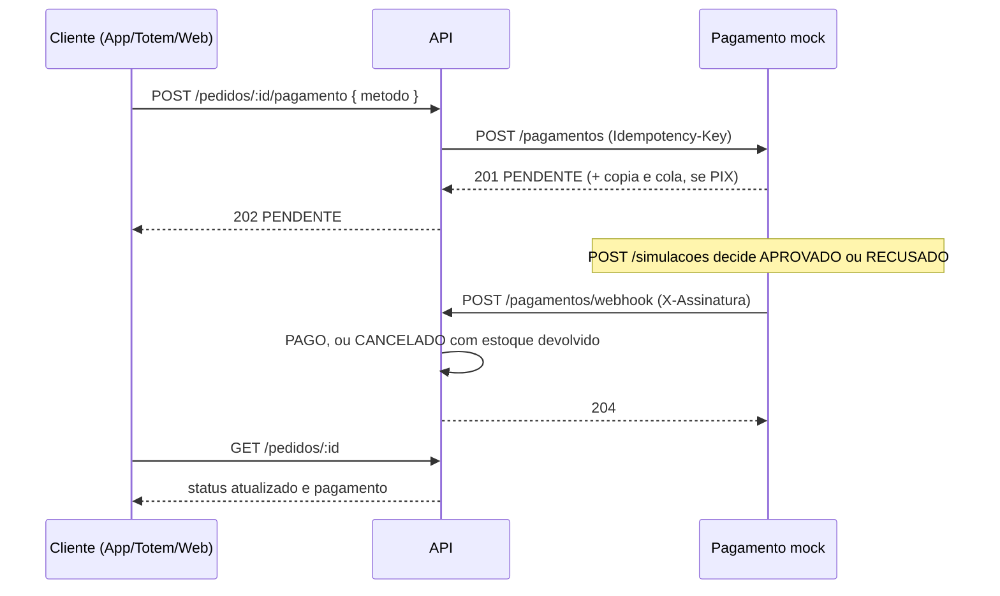

# Pagamento externo simulado

[Voltar ao README](../README.md)

## Pagamento

O pagamento fecha o fluxo crítico (pedido, pagamento externo, atualização de status). A rede não processa pagamento: como pede o caso, a API **solicita** o pagamento a um provedor externo, **recebe** a confirmação ou a negativa, **registra** o resultado e **atualiza** o status do pedido. O provedor é simulado pelo serviço [`pagamento-mock/`](../pagamento-mock/README.md), que roda em processo separado, como rodaria um gateway de verdade.



### Como demonstrar

Com a pilha no ar (`docker compose up --build`):

1. Faça login com `cliente@raizes.test` e crie um pedido em `POST /api/v1/pedidos`.
2. Peça o pagamento em `POST /api/v1/pedidos/{id}/pagamento` com `{ "metodo": "PIX" }`. A resposta é `202` com o pagamento `PENDENTE` e a `referenciaExterna`, o identificador no provedor.
3. Decida o resultado no mock: `POST http://localhost:4000/simulacoes` com `{ "pagamentoId": "<referenciaExterna>", "resultado": "APROVADO" }` (ou `"RECUSADO"`, com `motivo` opcional). É o papel do cliente pagando no app do banco, ou do emissor recusando.
4. Consulte `GET /api/v1/pedidos/{id}`: aprovado deixa o pedido `PAGO`; recusado deixa o pedido `CANCELADO`, o pagamento `RECUSADO` com o motivo, e o estoque de volta ao saldo anterior.

### Decisões

- **Assíncrono, como num provedor real.** A solicitação responde `202` e o resultado chega depois, por webhook. PIX, um dos métodos aceitos, é assíncrono por natureza: o cliente paga no app do banco e o provedor avisa. O `202` informa o que se sabe naquele momento, e o cliente acompanha o desfecho pelo `GET /pedidos/:id`.
- **Recusa cancela o pedido e devolve o estoque.** O pedido vai para `CANCELADO`, o pagamento para `RECUSADO` com o motivo, e cada item volta ao saldo com uma movimentação de `ENTRADA` vinculada ao pedido, tudo numa transação. Manter o pedido aberto para nova tentativa obrigaria a reservar o estoque de novo no meio do pagamento, ou a segurá-lo indefinidamente; para tentar outra vez, o cliente cria um novo pedido.
- **O registro guarda o envio e o retorno.** `pagamentos.payload_requisicao` tem o que foi enviado ao provedor, `payload_resposta` a resposta da solicitação e `payload_webhook` o evento com o resultado, além de `referencia_externa` e `processado_em`. O envio não leva dado pessoal do cliente, só a referência, o valor em centavos, o método e o código do pedido.
- **Sem dados de cartão.** A captura do cartão é responsabilidade do app cliente junto ao provedor, como fazem os gateways reais. A API recebe só o método, e nem ela nem o mock veem número de cartão, o que tira a API do escopo mais pesado de conformidade de cartões e reduz o que há a proteger sob a LGPD.
- **`DINHEIRO` fica fora desta rota.** Dinheiro não passa por provedor externo; é confirmado no balcão pelo atendente, fluxo que ainda não está implementado. A rota aceita `PIX`, `CARTAO_CREDITO` e `CARTAO_DEBITO`.
- **Rota aninhada no pedido.** O §6.1 do roteiro organiza `/pagamentos` como recurso de simulação e confirmação. Aqui a solicitação fica em `/pedidos/:id/pagamento`, porque o pagamento pertence ao pedido e a existência, a posse e o status são todos checados nele; a confirmação é `/pagamentos/webhook`.

### Idempotência

O provedor entrega cada evento ao menos uma vez, e o cliente pode repetir a solicitação depois de um timeout. Nenhum dos dois casos cobra ou devolve estoque duas vezes:

- **Solicitação idempotente por pedido.** O pedido fica bloqueado (`SELECT ... FOR UPDATE`) durante a checagem, e um pedido tem no máximo um pagamento (`pagamentos.pedido_id` é único). Repetir a chamada com o mesmo método devolve o mesmo pagamento; com outro método, é `409 PAGAMENTO_EM_ANDAMENTO`.
- **Chave de idempotência no provedor.** A API envia `Idempotency-Key: pagamento-<id>`. Se o provedor não respondeu, a nova tentativa reusa a mesma chave, e o provedor devolve o pagamento original em vez de criar outro.
- **Webhook idempotente.** O pedido e o pagamento ficam bloqueados durante o processamento, e um resultado para um pagamento que já não está `PENDENTE` é ignorado com `204`. O mock entrega cada evento duas vezes de propósito (`WEBHOOK_DELIVERIES=2`), para exercitar isso.

Há testes que disparam solicitações e entregas simultâneas enquanto o pedido está bloqueado e exigem um único pagamento e uma única devolução de estoque; sem os bloqueios, eles falham.

### Falhas do provedor

A chamada ao provedor fica fora de qualquer transação, para não segurar bloqueios do banco enquanto espera a rede. Falhas transitórias (rede, timeout, status 5xx) são retentadas com espera exponencial e a mesma chave. Esgotadas as tentativas, a resposta é `503 GATEWAY_PAGAMENTO_INDISPONIVEL`, o pagamento fica `PENDENTE` sem referência externa, e repetir a chamada retoma de onde parou. Uma resposta fora do contrato, validada com VineJS, vira `502 GATEWAY_PAGAMENTO_ERRO`. O mock simula indisponibilidade com `FAILURE_RATE`.

### Segurança do webhook

O webhook não usa token: quem chama é o provedor. A autenticidade vem do cabeçalho `X-Assinatura: t=<unix>,v1=<hmac>`, um HMAC-SHA256 de `<t>.<corpo bruto>` com o segredo compartilhado `PAGAMENTO_WEBHOOK_SECRET`, comparado em tempo constante. Assinatura ausente, inválida ou com mais de 5 minutos responde `401 ASSINATURA_INVALIDA`, o que barra tanto um corpo adulterado quanto a repetição de uma entrega capturada. Além disso, o valor e o identificador do provedor são conferidos com o pagamento registrado (`409 PAGAMENTO_DIVERGENTE`).

### Limitações conhecidas

- O mock guarda o estado em memória. Se ele reiniciar com pagamentos pendentes, esses pagamentos não recebem mais resultado.
- Se o provedor esgotar as tentativas de entrega do webhook, o pagamento fica `PENDENTE`. O mock já expõe `GET /pagamentos/:id`, e uma rotina de conciliação que consulte os pendentes antigos é o passo seguinte, ainda não implementado.
- Um pagamento pendente segura o estoque do pedido pelo tempo que durar, pela mesma razão descrita na criação de pedido.

### Mock no Docker, API no host

Também dá para subir só o mock em container e manter a API no host. Duas coisas mudam em relação ao Compose completo:

- dentro do container, `api:3333` não existe e `localhost` é o próprio container, então o webhook precisa apontar para `host.docker.internal`, e o segredo precisa ser o mesmo do `api/.env`;
- a API precisa escutar em todas as interfaces (`HOST=0.0.0.0`), porque o `HOST=localhost` do `.env` só aceita conexões do próprio host, e o container chega por outra interface.

```bash
PAGAMENTO_WEBHOOK_URL=http://host.docker.internal:3333/api/v1/pagamentos/webhook \
PAGAMENTO_WEBHOOK_SECRET=troque-este-segredo \
docker compose up pagamento-mock

cd api && HOST=0.0.0.0 npm run dev
```
